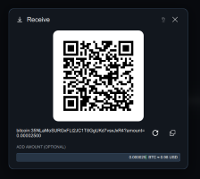

# wikiSpyder

<!-- Codename: Michelle -->

Advanced Wikipedia Search Tool

> [!IMPORTANT]
> **Codename: Michelle**
>
> wikiSpyder 1.0.0 is the Michelle build.

# ABOUT wikiSpyder
The goal of this app/utility is to assist users, researchers and investigators of any kind, as well as students, journalists, or anyone who likes to use Wikipedia while searching for information. 
What it will do is scrape the REFERENCES section posted last in most Wikipedia search result pages. After which wikiSpyder can be deployed to crawl the URLs (websites) or the list of links that were scraped from the REFERENCE sections.
While on the hunt, it will search for user provided search terms, keep a tally of how many times the search terms was found on the landing page of each link, notify the user of which page each search terms was found, and list how many times a search terms was found per visited URL.

It can speed up the search process considerably for working professionals or anyone who may know precisely what information they are looking for if the information (search terms) is linked or appears on the landing page of the targeted URLs.
From there the user can peruse an additional manifest of links annotated with a count of how many times each search terms(s) was found per link along with the tallied search term.
If you like, wikiSpyder will continue to crawl until you've narrowed down the site with the information you were looking for.


- Sites where no search termss were found, or anomalies where the landing page is mostly video or audio presentations are marked as NULL. They can still be accessed manually for eyes-on investigations. Just click the highlighted link to explore with your browser.

- wikiSpyder has a button which will release it to crawl recursively into each listed website if permitted or plausible, and as deep as the target will allow.

- Additional sources (i.e.. URLs, web addresses) can be added/removed before and during deployments.

- wikiSpyder can save all images automatically, if Save Images is checked.

- Search sessions, reference links, term counts, action history, and the displayed output are saved in the per-user session archive and restored when the app next opens. Temporary downloaded image files are purged when the program exits.
- Use the **Sessions** menu to reopen saved research, and **File → Export Current Session** to write one session to its own CSV file. **Options → Restore Latest Session on Startup** controls automatic restoration.

# Installation

wikiSpyder 1.0.0, Codename Michelle, targets **Python 3.12**.

## Install a release (recommended)

Download the installer for your operating system from [GitHub Releases](https://github.com/odioski/wikiSpyder/releases):

- **Windows:** run `wikiSpyder-*-windows-x64-setup.exe`.
- **macOS:** open the matching `.dmg` and drag wikiSpyder to Applications. The current images are unsigned; macOS may require opening the app through **System Settings → Privacy & Security** the first time.
- **Linux:** make the `.AppImage` executable, then open it. For example: `chmod +x wikiSpyder-*.AppImage`.

Release files bundle Python and the required libraries, so end users do not need to install Python. New releases are built for Windows x64, Linux x64, macOS Intel, and macOS Apple Silicon.

Session history is kept in the operating system's per-user application data folder. Temporary images are kept in its cache folder and removed when the app closes. Existing `tally.csv` data in a source checkout is copied into the new user data location on first launch.

## Install from source

Clone the repository and create a virtual environment:

```bash
git clone https://github.com/odioski/wikiSpyder.git
cd wikiSpyder
python3.12 -m venv venv
source venv/bin/activate
python -m pip install --upgrade pip setuptools wheel
python -m pip install .
```

This installs the package and runtime dependencies declared in `setup.py`. Launch it with:

```bash
wikiSpyder
```

To run from the checkout without installing the package, install the pinned requirements and start `main.py`:

```bash
python -m pip install -r requirements.txt
python main.py
```

If using Visual Studio Code, open the workspace file:

```bash
code wikiSpyder.code-workspace
```

## Build a release locally

On the operating system you want to package, install the build dependencies and create the bundled app:

```bash
python -m pip install -r requirements-build.txt
python packaging/build_app.py
```

The `dist/` folder contains the platform bundle. The tagged GitHub Actions release workflow wraps it in the Windows installer, Linux AppImage, or macOS disk image and attaches those files to the release.

## Local release checks

Before cutting a release, run:

```bash
venv/bin/python -m py_compile __main__.py main.py setup.py wiki_spyder/*.py
venv/bin/python -c "import main, wiki_spyder.newwindow"
QT_QPA_PLATFORM=offscreen venv/bin/python -c "from PyQt6.QtCore import QTimer; from PyQt6.QtWidgets import QApplication; import main; app = QApplication([]); window = main.MainWindow(); window.show(); QTimer.singleShot(0, window.close); QTimer.singleShot(0, app.quit); raise SystemExit(app.exec())"
```

Then do a quick manual pass in the GUI:

- launch the app
- fetch references from a known Wikipedia page
- run **Deep Probe**
- Deep Probe follows same-host links from the selected references, checks each host's `robots.txt`, and defaults to 100 pages per host with at least one second between requests. Adjust the page limit and request spacing in **Options → Deep Probe Settings**.
- open **View Images**
- confirm closing the app clears temporary downloaded images

# Gifts

If you'd like to buy me a cup of coffee that would be very kind of you.

Donations are accepted here: PAYPAL | If you'd like to remain TOTALLY anonymous it's completely UNDERSTOOD by me. Such proceeds are accepted here: BITCOIN WALLET.

<span style="width: 50px, height: 50px;"></span>

If you would like to see additional features added or have a suggestion, you can send me a note: score+@bookmotives.com


...
